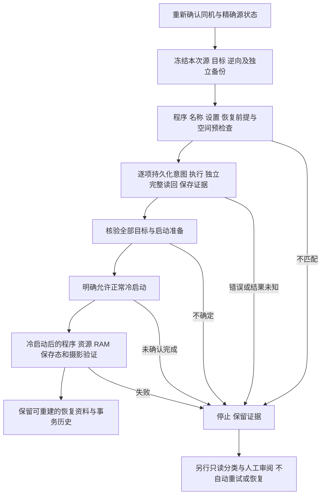

# 全项目实现与回滚安全评估

评估日期：2026-10-22。代码基线：`6da8b41182521dac53a80428547cdd8486abe8e1`。本轮新增评估文档、维护计划和入口链接，未改变安装、采集、写入、恢复、指纹或上游锁；未连接或操作相机，未读取私人机身材料，未提交或推送。

**结论：可以继续使用和开发机外工具；现有证据不足以承诺机内更新可可靠回滚，更不足以承诺断电不变砖、变砖后可救回或后续官方更新一定成功。新 LUT 写入应继续停在 D5 门槛之前。** 旧 FL23 有严格的防错与完整候选撤销实现，但通用版安装/恢复尚未实机验证；新 LUT 有较完整的离线逆向资料，尚无本项目机内事务及真实恢复闭环。已有保护值得保留，不能为“能恢复”而放宽未知状态检查。

用户随后明确本阶段以持续供电、提前留出收尾预算、每轮优先保障相机可用为前提。按此范围的[更新与安全收尾方案](POWERED-UPDATE-SAFETY.md)不再要求首版证明任意掉电救砖，改以合法阶段恢复、实际终态和冷启动验收为重点；仍未开放设备写入，也不将30分钟预算当强制中断或成功保证。

## 1. 评估范围与证据

范围包括机外 CUBE/原生拟合、单槽目标与私人包、设置/名称/程序 worker、首次内部采集、合成事务日志、旧 FL23 安装与恢复、USB 生命周期、来源及隐私保护、发布与验收计划。重点逐段审阅有持久化和恢复影响的路径；本次不是所有固件指令、第三方依赖及所有历史研究文件的形式化审计。

证据分三类：本轮读到的当前源码与合成检查；仓库记载的历史硬件证据；本轮查到的索尼官方更新说明。历史实机记录没有在本轮重跑。测试数量不能换算为变砖概率，当前没有足够样本计算该概率。

| 子系统 | 已实现 | 仍缺什么 / 本轮判断 |
| --- | --- | --- |
| M1/N2 机外预览、拟合、误差与验收准备 | 可运行的离线入口、严格输入和候选绑定；超限不伪装为通过 | 真实 Sony ST、独立摄影场景、预览与机内 JPEG 一致性未验；可继续机外使用，不能据此解锁写入 |
| N3 单槽目标与私人包 | 完整 AP/CP 来源、正反向重建、68 资源、150 个 payload 独立重验；设置保持限定作用域 | 包证明冻结字节可逆，不证明当前机身一致、物理写入可逆或完整 BK4 容器可恢复 |
| 程序/名称 worker | 固定 C 来源、包与头绑定、离线编译/ABI/ELF检查、严格报告结构 | 没有本项目设备部署/触发闭环；报告格式符合不证明由本次设备调用产生 |
| D2 设置方案 | 九个描述符派生单元、RAM/保存值前提、精确逆向、保存前保护及顺序要求 | `executor_enabled:false`；实际属性写入/保存及其他运行组影响未验 |
| D4 首次内部采集 | 显式入口、共用全局锁、白名单读取、期限/长度检查、信号与退出回执 | 已有真实电脑库加载记录，但没有本项目实际通信/退出/74材料正例；认证和选读仍属设备操作 |
| 合成事务日志 | 意图先落盘、原子发布、文件/目录同步、哈希链、进程锁、中断只读分类 | 五个128字节合成组件；没有相机适配器，不能直接当真实事务引擎 |
| 旧 FL23 | 默认单份同机备份、完整哈希、40个固定窗口、读回、设置保存、WBI、冷启动验证入口 | 仅固定旧提交的通用 `verify` 有一台机身实测；通用 prepare/install/restore、救援未验 |
| 真正任意 3D LUT 照片链 | 保留控制/消费链的静态研究 | 有效像素传输、MAIN身份和时序未闭合；不宜扩大成新的机内写入路线 |

当前实际版本沿用最近用户确认的原厂 2.00，不能当作已经升级至 2.01。本轮不需要为评估而升级。现有工具的设备支持条件仍是 ILCE-7CM2 原厂 2.01 与完整程序指纹，相关来源状态按各自固定策略检查。

## 2. 必须分开的四种“回滚”

| 能力 | 当前证据 | 前提 / 限制 |
| --- | --- | --- |
| 在电脑上计算出更新前的字节 | 已有较强离线证据 | 正反向完整哈希、资源逆向、设置作用域一致；不触及设备可达性 |
| 正常运行的相机撤销已完成改装 | 旧工具有代码，新工具未集成 | 相机可进入通信，机身/版本/当前完整目标和本人备份相符；旧通用 restore 也未实机验证 |
| 中断后继续或恢复部分写入 | 当前项目没有通用入口 | `needs_review` 阻止继续；固定程序 worker 不接受任意混合镜像；专项 diagnose 只收集证据 |
| 无法启动时救砖，或官方固件降级 | 没有已验证能力 | 无已验证独立恢复环境、A/B启动切换、维修级重刷闭环；AP/CP备份不是全闪存镜像 |

“自动回滚”还需区分：原生 worker 在进程仍活着、系统调用返回可处理错误时，会尝试在同一调用内撤销局部改动；主机在 USB 结果未知后不会再自动启动一次恢复。这两者不矛盾。掉电、内核崩溃、存储失效可能使前一种撤销根本没有机会执行。

## 3. 优先风险与具体依据

P0 表示承诺“可靠回滚/断电可恢复”或开放新写入前的阻断条件，不表示已确认每次安装必然损坏。P1 表示恢复能力或证据的重要缺口；P2 表示后续加固项。

### R1 / P0：程序、设置、资源与开机状态不是一个原子事务

旧包 `app.py:159–176` 依次写程序、读回、保存设置、处理 WBI；`native/installer.c:96–104,124–139` 对多个 AP/CP 窗口原地写入，窗口循环后分别 fsync、完整校验，失败时尝试反向写。它没有跨 AP/CP 的原子提交，也没有覆盖后续设置/WBI的统一撤销。

新路线还加入68份名称资源。固定 v2.1 `names.c:174–195` 是逐文件暂存、硬链接备份、逐文件 rename，再整组核验；单文件替换不能使68文件加程序和设置一起原子切换。即使只导入一个槽，也不等于只写一个小文件。

**影响：** 中断可留下“资源新/程序旧”“部分程序新/部分旧”“程序新/设置部分保存”“磁盘新/启动快照旧”等组合。少量补丁、fsync、完整读回和单文件 rename 都不能证明断电安全。没有独立可启动恢复环境时，纯主机侧代码无法保证不变砖。

**后续：** 对每个真实持久化动作建立合法前后状态和恢复前提；优先减少写入对象和次数。不要擅自把 inode 保留的程序原地写改成整文件 rename，也不要添加未经证明的 A/B 或启动钩子。若目标要求“掉电后仍可自主恢复”，先证明不依赖被修改应用的恢复通道；未证明前不得宣传此能力。

### R2 / P1：正常 restore 覆盖不到最需要恢复的中断状态

[CLI](../macfl23/cli.py) 89–102行只允许从已安装/已验证阶段进入 restore；176–193行将已开始操作的异常保存成 `needs_review`。因此 **verify 失败也可能阻断普通 restore**，即使失败来自通信或检查，而不是又写了程序。

旧包 `app.py:196–207` 在恢复前先要求完整程序等于 `core.FINAL`，再还原设置、程序和WBI。混合/损坏程序会在写入前拒绝。[diagnostic.py](../macfl23/diagnostic.py) 148–152行仅处理 `install/writing_settings` 这一类中断；它不是恢复执行器。上述限制通过本轮合成调用复核。

**判断：** 拒绝未知状态是正确保护，不能删除。问题是保护后缺少经过验证的分类与处置路径。不能用修改 state.json、忽略哈希、换别人的备份或直接调用底层 worker 来“解锁回滚”。

**后续：** 首先实现独立的只读事故检查，保留最后一次成功事实、失败操作和当前观察，三者分开。只有新鲜完整读回证明属于预先审阅的合法状态时，才能另行产生有限恢复方案；不得从错误文字或旧日志直接决定继续。部分程序修复需要专门审阅的实现及验证，当前 mode2 不能承担。

### R3 / P1：旧工具持久化证据不足以作为掉电后的可靠依据

旧包 `core.py:26–32` 对临时 JSON 执行文件 fsync 后 replace，没有同步父目录；[workflow.py](../macfl23/workflow.py) 16–23行保存新备份也只有文件 fsync/读回。旧包的原生报告、设置证据和完整读回多处直接 `write_bytes`，没有统一的文件/目录持久化提交。主机突然掉电或磁盘故障时，不能由返回成功推断所有目录项和证据已稳定保存。本轮对调用轨迹的检查确认前两条路径没有目录 fsync；**没有进行实际掉电试验，不能声称已复现数据丢失。**

[customjournal.py](../lutphoto/customjournal.py) 90–107行已有更完整的合成发布机制，但其真实相机集成和掉电验证标志仍为false，不能直接移植模拟现场/操作顺序。

**后续：** 在适配层新增独立、排他、不可覆盖的真实事件日志：写入意图先同步，设备调用后完整读回，再保存验证事件；原始备份、清单、关键结果均做文件/父目录同步和重新打开核验。关键证据保存失败时停止后续变更，保留原始异常和残留文件；异常处理不得依赖同一故障磁盘再次写成功。检查主机容量和 inode 预算，区分容量检查与实际预留；实际电源失效持久性仍须单独验证，不把目录同步当硬件保证。

### R4 / P1：“恢复完成”缺少专用冷启动闭环，现有 verify 的保存态措辞偏强

[CLI](../macfl23/cli.py) 94–99行的 verify 不接受 `restored_pending_cold_start`；[状态说明](STATE-MACHINE.md)明确现有 verify 只面向FL23安装结果。旧 restore 返回时只证明本次调用内原程序和目标设置的读回，不证明下次启动、拍摄、菜单和升级入口正常。

另一个已存在的限制是旧包 `app.py:179–195` 的 verify 只调用 `getBackupPresetData(True)` 检查当前设置，没有独立调用False读保存态；安装时的 `settings()` 才读取两者。冷启动确认是人工标志，代码不验证实际取过电池。因此当前文档的“保存参数已验证”应解释为安装时的直接证据与真实冷启动后当前值的间接证据，不能称本次 verify 独立读过保存区。

**后续：** 增加针对源状态的恢复后验证：完整 AP/CP、全部适用资源、直接属性、RAM及保存快照、允许范围内的启动/运行状态、普通USB返回；人工完成正常冷启动与摄影/回放。把设备结果、人工确认和官方更新兼容性分开记录。新验证入口完成审阅前不提供虚构命令。

### R5 / P1：新 LUT 的离线资料尚未绑定真实事务及连续更新历史

[slottarget.py](../lutphoto/slottarget.py) 47–83行及[slotbundle.py](../lutphoto/slotbundle.py)已有精确正反向检查；[settingsplan.py](../lutphoto/settingsplan.py) 72–99行明确正逆顺序及执行器关闭；[workercontracts.py](../lutphoto/workercontracts.py) 176–220行仅验证输入报告结构。程序报告没有本次作业新鲜度证明，名称报告甚至不含资源哈希或作业ID。68个成功计数不能代替68个实际资源的完整读回。

名称清理不是“删除后必然不能恢复”：固定 v2.1 `names.c:117–138,161–189` 可从精确目标资源重建原资源，核对完整原哈希后还原；这依赖精确目标、对应元数据、正确AP状态及可执行通道，不能用于损坏资源。应保留这一边界，避免误报缺陷或高估保障。

**后续：** 每次更新都保存“本次更新前”的完整作用域基线与事务父节点，并明确回到上一版还是最初原厂。写入前重新绑定机身、当前AP/CP、资源、RAM/保存态、来源锁、工具与worker摘要、用户选定槽；检查“旧备份有效但当前机身已变化”的冲突。旧报告不能作为新调用凭证；在调用生命周期内建立证据关联并独立全量读回。固定ABI无作业字段时不能凭空宣称具备认证能力；新增协议需另行版本化审阅，不能修改旧固定锁来冒充已验证上游。

### R6 / P0（对官方更新兼容承诺）：没有改装→原版→官方升级的验证链

项目保存的程序/设置/资源不能等价于官方全固件、完整闪存或跨版本恢复镜像；恢复本次改动也不能证明机身所有分区均为出厂状态。当前没有证据证明改装状态可直接官方升级、同版本可重刷、2.01可退回2.00，或升级至其他版本后还可恢复本项目的2.01备份。

本轮核对的[索尼 ILCE-7CM2 2.01 官方更新页](https://www.sony.com/electronics/support/e-mount-body-ilce-7-series/ilce-7cm2/software/00301105)说明了正常菜单更新路径，要求实际电量至少51%、建议充满，并警告更新中断电可能使相机无法使用；该页面没有提供本项目改装/损坏镜像的通用救援承诺。官方特定故障灯号的处理仅适用于该官方流程，不能套到本项目未知写入状态。

**后续：** 将“撤销改装并验证受影响范围”与“官方升级”作为两个独立操作。未来升级前先完成源状态恢复和冷启动核验，再按当时该机型官方说明单独评估、单独授权。新固件建立新来源与新备份；当前固定2.01工具必须拒绝它，不复用旧偏移或把旧备份跨版本写回。没有同版本重刷或降级证据时明确写“未验证”，不把官方升级包当万能保险。

### R7 / P2：供应链、空间、信号和证据维护需随真实执行器一起收口

已做：固定上游ZIP/文件清单与SHA、限制解包、私有路径和防链接、合作进程的全局锁、USB身份/端口绑定、未知通信后停止。新采集还具备SIGINT/SIGTERM边界及主机容量检查；这些不代表旧写入器具备相同覆盖。

剩余：Python依赖固定版本但未锁下载文件哈希；本轮没有漏洞扫描、完整固件二进制审计或旧发布模块的独立可复现构建证明。新写入需验证相机侧暂存/回滚空间与 inode 预算、信号/关闭失败路径；“先检查有空间”仍不保证写入期间空间不耗尽。本地哈希链没有外部可信锚，不能抵抗有权限者整体重写历史。全局锁只约束合作工具，不能阻止其他软件或硬件故障。

## 4. 故障与恢复边界矩阵

此表用于设计和判断，不是对现有事故执行相机操作的授权。

| 现场 | 当前能做什么 | 不能推断什么 / 后续缺口 |
| --- | --- | --- |
| 写入前检查拒绝 | 保留资料；按拒绝原因审查 | 不应放宽固件、身份、备份或空间门槛 |
| worker运行中返回错误，局部撤销报告成功 | 保留报告，后续仍需独立完整读回及状态审阅 | `rollback=0`不是整机事务成功，也不能覆盖设置/WBI |
| 程序或资源写到一半，USB断开/主机被杀 | 停止后续命令，保留当前会话与本地证据 | 主机停止不表示机内worker停止；不立即取电池，不重跑写入；当前无通用恢复 |
| 程序完整目标，设置失败 | 保留现场；仅符合专项条件并另行明确选择时才考虑现有diagnose | diagnose尚未真机验证，不会恢复设置、执行WBI或解锁安装 |
| 仅明确的`*_usb_unconfirmed` | 按[阶段说明](STATE-MACHINE.md)与[故障表](ADVANCED.md)处理 | 只有本次操作主体、服务退出证据完整的专用结果适用；其他超时不算成功 |
| 已完成且机身可通信，希望撤销FL23 | 旧restore具备限定入口；须符合本人备份、完整候选、ST/冷启动/实际电量等前提 | 通用恢复未实机验证，恢复后仍无专用verify闭环 |
| 更新LUT后又更改了菜单设置或叠加另一改装 | 应比较当前状态与本次事务目标，出现冲突即停 | 不能直接拿最初备份覆盖用户后来修改，不能跨事务套逆向 |
| 黑屏/无法普通启动/服务入口不可用 | 保留记录，转入已验证的独立救援或索尼支持/维修评估 | 本项目无已验证救砖路径；卡副本、AP/CP备份、任意官方DAT都不是保证 |
| restore中途失败或恢复后不能正常拍摄 | 同样进入待审查，保留全部资料 | restore本身也会写入和失败，不是天然安全操作 |
| 升级到不同官方版本 | 建立全新兼容性与备份基线 | 不允许2.01原程序/偏移跨版本恢复；不得承诺降级 |

## 5. 后续实现顺序与可验收交付

以下是建议实施清单，**本轮没有实现这些新入口，也没有批准D5设备写入**。保持D1–D3已有工具，不再用更多模拟数量替代真实材料。

| 顺序 | 交付 | 完成判据 |
| --- | --- | --- |
| S1，D5代码前 | 恢复范围和状态分类规范；纠正verify证据措辞 | 明确上一版/原厂两个目标、事务作用域、合法中间态、未知停止、恢复后验证及无法启动的外部处置；每个状态有证据要求 |
| S2，可先离线 | 真实事件日志与事故只读检查、恢复后验证的代码与拒绝测试 | 保留最后成功证据，不靠覆盖phase推断；文件/目录同步、ENOSPC/关闭/中断测试；检查器绝不调用写入/保存/WBI，状态缺失或损坏拒绝放行 |
| S3，D4 | 一次本人真实只读首采及离线重验 | 实际机型/版本/电量、权限和范围已确认，精确原厂2.01；完整AP/CP、首末RAM/保存设置、68资源、退出和回执独立核验；没有把采集当写入许可 |
| S4，D4后 | 本人恢复资料包和真实执行/恢复方案审阅 | 同机本次源/目标/逆向、来源与工具锁、资源/设置/重载状态清单可重建；核验两份独立物理介质副本；明确启动依赖及救援缺口；先验证恢复计划，再开放安装接口 |
| S5，受控实验前 | 单槽执行器及有限恢复执行器，正反路径共同验收 | 每个动作前置条件、容量、日志、触发与独立读回、未知停止完整；首次只支持一种明确源状态；部分镜像恢复未通过审阅前持续拒绝 |
| S6，另行设备安排 | 测试机上的完整正反循环、冷启动/摄影/更新兼容性记录 | 同一冻结版本完成源→目标→源，核验字节/设置/资源、正常启动/拍摄/回放；第二轮更新能回到上一版；官方升级和更换机身另列证据 |

**关键闭锁：** S4不能只检查“存在backup目录”；S5不能只检查“check-report通过”；S6不能只检查“菜单出现”。写入门槛应消费真实证据，并为未完成项返回拒绝，而不是靠文档提示或手填一个通过布尔值。

### 单次事务的建议流程

实际新LUT顺序仍以[设置方案](SETTINGS-PLAN-OFFLINE.md)为审阅起点：名称在源AP下更新并全量读回，然后程序更新及读回，再处理目标程序下的设置；逆向先设置、再程序、最后源AP下恢复名称。重载/WBI和冷启动必须另行闭合，不能简单反转函数列表。建议流程中的“逐项”不要求主机在原生worker内部逐窗口通信；不能虚构现有原子执行边界。

### 备份与连续更新

- 采集默认仍只做一份，之后在另行安排的独立物理介质上核验副本；不主动添加`--backup-copy`。两个目录、同盘不同分区、同机APFS卷均不能直接当两份物理容灾。
- 私人恢复包至少保存受影响的完整AP/CP、全部原名称资源、原RAM/保存快照及相关元数据、源/目标/逆向、机身与版本绑定、来源锁、必要工具/构建来源及日志。这里“完整”限已列作用域，不能称完整闪存备份；不盲目覆盖整份校准/设置容器。
- 保留最初原厂基线和每次更新前基线，事务父节点及完整哈希形成明确链。L1→L2的撤销目标是L1；回到原厂是另一份经过检查的方案。事务包与对应构建资料不能在下一次更新中覆盖。
- 备份清理应在冷启动、资源/程序/设置和摄影验收之后；主机恢复包长期保留。名称副本可重建的事实不构成提前删除所有独立备份的理由。
- 归档可在不访问相机时定期重新打开、复算及重建；这验证资料可读，不证明相机可救回。私人数据不得提交、推送或随问题日志公开。

## 6. 验证策略与发布判据

已有回归可发现软件分支错误，新增检查应围绕真实缺口，避免再建平行模拟框架。建议新增：意图落盘失败、目录同步失败、短写/ENOSPC、最后一窗口之后/结果保存之前中断、设置写入与保存之间中断、68资源第N次rename失败、WBI前后失败、返回MSC失败、原备份丢失/更换机身/第二次更新冲突。主机和机内worker失败分别建模；合成程序或子进程SIGKILL不能称相机断电测试。

真实验证应先有独立救援准备、专用测试机和明确授权，再做正常单槽正反循环。故意拔电池/断线不是当前用户相机上的默认验收步骤；危险的掉电实验只能作为独立受控项目，在可承受损失并具备恢复能力后安排。不得用更多合成样本宣布这部分通过。

| 发布声称 | 最少需要的证据 | 当前状态 |
| --- | --- | --- |
| 机外拟合/预览可用 | 可复现CLI、数学/输入及错误路径检查，明确模型限制 | 已具备 |
| 当前冻结版本可在指定机身安装 | D4真实材料、D5审阅及该版本完整正向实测 | 新LUT未具备；旧通用安装也未实测 |
| 可撤销到指定源状态 | 同版本真实逆向、完整读回、冷启动、摄影和用户设置保留 | 未具备 |
| 可处理中断 | 明确故障类别的检测和恢复实测，记录不覆盖类别 | 未具备通用能力 |
| 断电不变砖 / 变砖可自救 | 独立恢复架构、真实故障验证及清楚的硬件失效边界 | 不能承诺 |
| 兼容未来官方升级 | 对具体源改装、恢复基线和目标官方版本的单独验证 | 未具备，不能泛化 |

## 7. 本轮实际检查和结果

运行环境：项目现有 `.venv`，Python 3.14.6。没有安装/升级依赖、执行setup、运行原生机内模块、枚举USB、读取PRIVATE、采集或刷机。既有测试采用mock/合成材料；全套回归也不等价于重跑历史隔离环境的所有真实交叉编译。

| 命令 / 检查 | 结果 |
| --- | --- |
| `.venv/bin/python --version` | Python 3.14.6，退出0 |
| `.venv/bin/python -B -m macfl23 check` | 固定上游源码/资产完整，退出0 |
| `.venv/bin/python -B -m unittest discover -s tests -v` | 39项通过，退出0 |
| `.venv/bin/python -B -m unittest discover -s .upstream/a7c2_fl23_preview/tests -v` | 8项通过，退出0 |
| `.venv/bin/python -B -m unittest discover -s research/tests -v` | 980项通过，退出0；合计1027项 |
| `.venv/bin/python -B -`，内联固定来源核验 | v2.1归档SHA及程序/名称C与固定审计锁一致，退出0 |
| `.venv/bin/python -B -`，内联合成边界探针 | 5项断言通过，退出0，见下文；没有修改生产哈希/状态或连接设备 |
| `.venv/bin/python -m pip check` | 无依赖冲突，退出0；有宿主缓存不可写提示，未修改权限；不是漏洞扫描 |
| `.venv/bin/python -B -`，内联文档链接/公开范围检查 | 4份文档、88个本地链接目标及格式/代码围栏/个人路径检查通过，退出0 |
| `git diff --check` | 退出0；仅文档变更，其他受跟踪代码/资产/锁文件无差异 |

5项探针分别确认：①needs_review及已恢复阶段不能普通restore；②一次合成verify失败改成needs_review并阻止普通restore；③完整程序不匹配在恢复写入前拒绝；④隔离verify路径只请求True当前快照；⑤state替换与新备份写入只同步文件、不同步目录。探针使用临时目录和替身会话，仅为分支/系统调用轨迹验证；其中替代了解码和runtime结果，不能用于证明真实verify通过。没有执行掉电、救砖、官方更新、真实恢复或实际摄影验收。

固定旧预览包来自QAQLeonard提交 `dd01c07a2a5df004d709595a43ebafe81bbd8fae`，归档及成员由根`upstream.lock.json`约束；本页旧包行号对应本地校验后的 `a7c2_fl23_preview/app.py`、`core.py`、`native/installer.c`、`native/wbi.c`。新worker来源为QAQLeonard v2.1提交 `7e54d60b458847f1befa6cfd614fbf004b8b0b90`，由[worker审计锁](../research/upstream-worker.lock.json)约束；名称行号对应包内 `src/looks/native/names.c`。未修改这些来源。

现有[实机验证边界](VALIDATION.md)、[当前交接](../research/HANDOFF.md)及[交付计划](DELIVERY-PLAN.md)继续有效。本评估补充恢复门槛，不提高N3/N4或D4/D5的实机完成状态。贡献与许可继续按[ACKNOWLEDGEMENTS](../ACKNOWLEDGEMENTS.md)保留QAQLeonard、ma1co及其他上游署名。
