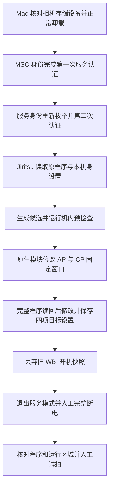

# a7c2-fl23-macos 项目原理与安全分析

分析日期：2026-10-18。结论针对本次拉取的固定版本。

- 本地目录：`/path/to/a7c2-fl23-macos`
- macOS 适配层提交：`5babef40bba986efdd0573380c0ff9f8a027495c`
- 上游工具提交：`dd01c07a2a5df004d709595a43ebafe81bbd8fae`，预览包 `0.1.0`
- 范围：阅读适配层、上游 Python、原生 C 工作模块和补丁清单，核验资产，执行离线测试。本次没有操作 USB 或相机，没有运行安装、诊断或恢复命令。

**判断：项目具有较完整的防误操作设计，但仍属于直接修改相机内部程序的实验工具。目前的证据不足以把它作为主力相机的可靠改装方案。** 所审主流程未发现自动上传机身数据、安装常驻服务或关闭 SIP 的逻辑；这不构成对所有二进制与第三方依赖的无恶意保证。

## 1. 它实现什么

目标是在 **Sony A7C II / ILCE-7CM2，原版固件 2.01** 上增加用于静态照片的 FL2、FL3 创意外观。显示版本号符合仍不够，两个内部程序的完整 SHA-256 必须匹配。

原始移植、色彩数据、补丁与机内安装模块来自 [QAQLeonard/a7c2-fl23-research](https://github.com/QAQLeonard/a7c2-fl23-research/tree/dd01c07a2a5df004d709595a43ebafe81bbd8fae)。MDHan 仓库主要增加 Mac USB 接管、备份落盘、状态管理、故障处理和中文 CLI。

上游说明色彩/曲线研究使用 Alpha 1 II 4.00 数据，并适配目标结构。代码确实同时修改菜单、处理路径、曲线、色彩映射和照片标识，涉及实际图像处理。与 Alpha 1 II 的严格实拍色彩一致性尚无验证；视频兼容、全部格式组合和长期稳定性也没有充分实测。

这条链路通过 USB 服务入口修改内部文件，不使用 Sony 官方存储卡升级流程，也不能据此推断官方升级签名校验已经永久失效。

## 2. 运行链路

**USB 接管。** `host.py` 从 IORegistry 定位 `054c:0e8a` 的存储子设备，检查它们确为外置 USB 磁盘，再调用普通 `diskutil unmountDisk`。随后由 libusb 临时接管接口。没有硬编码磁盘编号，也没有强制卸载、格式化或关闭 SIP。

**服务访问。** `session.py` 在普通 MSC 身份完成一次 Senser 认证，等设备重新枚举为 `054c:0336` 后再次认证。型号、序列号摘要与物理 USB 端口用于避免把备份用到另一台机身。

**机内执行。** 上游 `transport.py` 使用 Jiritsu 文件接口；`/tmp/jiritsu/../..` 路径可读取相机内部文件。上传固定模块到 `/tmp/jiritsu/libJit.so` 后，固件的原生加载入口执行其初始化函数，工作模块以相机内 root 权限完成限定操作，再输出结构化结果。当前工具使用这个临时加载入口；所审流程没有配置 `/etc/ld.so.preload`，且发现已有 preload 配置会停止。它与引用研究中的 preload/DEBUG 执行方式存在区别。

**程序修改。** 机内 `installer.c` 先检查全文件哈希、长度和窗口原字节，再临时将 `/usr` 切为可写，用固定偏移原地写入，保留 inode 和长度。写完执行 fsync、全文件校验并恢复只读。Mac 还会独立通过 USB 读回两个完整程序。

| 对象 | 作用 | 本次从补丁清单统计 |
| --- | --- | --- |
| `/usr/lib/appFw.so`，AP 侧应用 | 菜单可见性、选择能力、外观到处理模式转换、初始绑定和 Fade 默认值 | 8 个窗口，覆盖 134 字节，实际改变 111 字节 |
| `/cp/cpapp-b.bin`，CP 侧处理程序 | 曲线/模式表、色彩参数支持、边界与视频回退逻辑、照片标识 | 32 个窗口，覆盖 4,288 字节，实际改变 2,047 字节 |

40 个窗口合计覆盖 4,422 字节、实际改变 2,158 字节。改动字节少有助于限定范围，但不能用字节数量估算变砖概率。

**机身设置。** 工具把新增记录合并到本机身自己的两个 CP 单元：`0x02a40001`（8,192 字节）和 `0x02a4000d`（28,672 字节）。参数 55/56 对应空闲记录槽 23/25；已有映射、色彩数据及校准数据按检查结果保留。另把两个 AP 绑定 `0x02cf1287`、`0x02cf1289` 写为 `0a`、`0b`，并通过相机原生保存接口持久化。它不把另一台相机的整份设置覆盖进来。

**WBI 与冷启动。** 相机可能从旧开机快照恢复，造成磁盘程序已改但运行内容仍旧。模块通过现有 sysfs 接口按 `image_drop=1`、`image_mode=0` 的顺序丢弃旧快照，并检查状态和本轮日志。之后需要人工正常关机、等待存取灯灭、取电池约 10 秒。冷启动后的电脑验证读取完整程序及 AP 的六处内存/磁盘区域；菜单与实际拍摄仍需人工检查。

## 3. 已实现的保护

| 保护 | 能防止或检测的情况 | 边界 |
| --- | --- | --- |
| 锁定上游提交、ZIP 与逐文件哈希、精确文件清单 | 下载损坏、资产意外变化、额外文件混入 | 信任根仍是仓库及锁文件，不能防御可信来源本身被恶意修改 |
| 解包拒绝路径穿越、符号链接并限制大小 | 压缩包越界写入等问题 | 不等于模块功能已经获得独立认证 |
| 原程序与候选全文件哈希、反向补丁还原检查 | 错误固件、重复安装、候选不正确 | 不提供其他固件版本兼容性 |
| 型号、机身摘要、USB 物理端口检查 | 错机身、串用备份、服务切换后设备错配 | 不是针对恶意 USB 设备的强身份认证 |
| 私有目录权限、新文件独占创建、备份 fsync 与读回 | 误覆盖、普通跨用户读取、部分落盘错误 | 不能保证磁盘故障或断电后的数据完整性 |
| 相机操作锁、明确阶段、电量与人工冷启动标志 | 本工具并发操作、阶段错误和明显低电量 | 不能锁住其他相机软件；实际电量由人输入 |
| USB 超时/中断后停止后续命令 | 结果未知时继续写入或清理 | 停止不等于相机已恢复安全状态 |
| 区分主体完成与普通 USB 返回未确认 | 避免仅因退出等待超时而重复安装 | 只有具备完整证据的特定结果可作此分类 |

准备阶段默认保存八个备份文件：两份完整程序、当前与已保存设置容器、两个 CP 单元及两个 AP 绑定。**默认只有一份备份位置**；它不是全闪存/bootloader/WBI 镜像，也不提供物理容灾。可选额外副本应位于独立介质，并继续保留原工作目录。

## 4. 影响使用判断的风险

**安装不是原子事务。** 程序窗口、CP/AP 参数保存和 WBI 处理依次发生。原生程序窗口写入失败时有尝试回滚的代码，但断电、存储故障或后续设置/WBI 失败，不受一项跨对象事务保护。CLI 报错并停止，可能意味着相机已经发生部分永久改动。

**已有设置阶段中断报告。** 当前 README 和 `INTERRUPTED-INSTALL.md` 披露，Issue #2 在 `writing_settings` 因非目标属性 `0x02770015` 变化停止。源码显示安装先写程序、完成完整读回，再写并保存目标设置，最后进行额外属性变化检查；这个检查失败时，程序甚至目标设置可能已经落盘，WBI 收尾尚未执行。异常变化究竟是什么，现有证据不能直接确定，不能自行视作可忽略计数器。

新增 `diagnose` 只收集此类中断状态，限制为临时 runtime 模块，不推进安装状态、不续写或处理 WBI；它仍会进入服务模式，尚未真机验证。本次未成功取得 Issue 原始页面，上述报告内容以克隆仓库中的披露为据，没有独立复核报告者的原始日志。

**恢复不是救砖。** `restore` 先要求两个完整程序精确匹配已知安装候选，再恢复本机身原始数据。未知部分损坏映像、服务通道不可用或无法开机时，它不能提供通用修复。该仓库的恢复路径也尚未实机验证；“有备份”“存在恢复命令”和“能够救砖”不能等同。

**实机样本不足。** 按 `VALIDATION.md`，前身专用脚本在一台机身完成安装和基本试拍。本仓库仅有较早提交 `b2fc5ed` 的 `verify` 实机记录，复用了那台机身已有的工作目录。通用版首次 prepare/install/restore、第二台机身和安装中断后的收尾没有实机验证，不能把前身脚本的成功算成当前全部路径通过。

**验证范围有一处需要细分。** 上游 `app.py` 的 `settings()` 确实读取当前与存储设置并检查目标；但 `verify()` 调用的是 `getBackupPresetData(True)`，核对当前内存中的设置，没有在这条验证路径另行调用 `False` 去独立读存储区。确认冷启动后当前值一致可以提供持久化的间接证据，但不应把它表述为本轮单独完成了存储区读回。它也不自动确认人工是否真正取过电池。

**Mac 与供应链信任。** 相机操作需要 sudo，因此用户也在信任本地启动脚本、Python 模块、虚拟环境及第三方库。Python 依赖固定版本，但 `requirements.txt` 未固定下载文件哈希。四个机内 `.so` 已确认是 AArch64 ELF；本次阅读了相应 C 源码、验证了发布文件哈希，但未独立重编译或逐指令证明二进制与源码一致，也未执行第三方依赖漏洞扫描。

**隐私与后续兼容性。** 完整设置容器、日志和程序读回应按私有资料保管，序列号摘要也不等于所有日志都脱敏。所审主流程没有自动上传这些资料的调用。未来官方固件升级、重置、维修流程与其他型号的兼容性均不应从本项目推断。

## 5. 本次实际验证

环境：macOS 27.0.1、arm64、Python 3.14.6，独立 `.venv`。这与作者记录的实机环境不同，本次结果仅属于电脑端离线验证。

本次没有运行 `setup.sh`。在阅读源码后，单独创建虚拟环境、安装固定版本 wheel；从固定上游 Git 提交获取 ZIP，再调用已阅读的解包/校验函数展开到 `.upstream/`。

ZIP SHA-256：`2bbbf3942f2e1b8439242ec7fae703009645a4533473bafa7b41f542e13c6c75`，与锁文件一致；46 个文件的清单与 SHA-256 全部通过。

在项目目录执行的检查：

| 命令 | 本次结果 |
| --- | --- |
| `.venv/bin/python -B -m macfl23 check` | 退出码 0；源码和资产完整 |
| `.venv/bin/python -B -m unittest discover -s tests -v` | 39 项通过，退出码 0 |
| `.venv/bin/python -B -m unittest discover -s .upstream/a7c2_fl23_preview/tests -v` | 8 项通过，退出码 0 |
| `.venv/bin/python -m pip check` | 无依赖冲突，退出码 0；不是漏洞扫描 |

47 项测试使用模拟 USB 或合成数据，覆盖归档、备份、身份、超时、阶段限制、诊断约束与若干补丁/参数保护。它们没有验证实际传输、相机模块执行、拍摄质量、恢复能力或长期稳定性。上游文档还报告过额外仿真，本次没有重跑那些未随包提供的完整研究验证环境。

## 6. 使用建议与源码入口

适合作为移植与服务协议的研究项目继续阅读。若相机用于工作或无法承受停机，建议等待通用安装、真实恢复及多机身验证完善，尤其是已披露的设置阶段中断有实机处理结果之后，再考虑安装。当前无法给出有依据的成功率或变砖概率。

如未来决定承担风险，应先核实该固定版本支持条件与最新故障进展，保留本机身完整工作目录和独立备份；任何未知状态都先判明已完成的阶段。不要绕过校验、反复重装或用其他机身备份补齐。

关键源码入口：

- [Mac USB 与磁盘识别](../macfl23/host.py)
- [服务会话、身份、超时与退出](../macfl23/session.py)
- [Mac 备份、候选核验与完成证据](../macfl23/workflow.py)
- [CLI 权限、锁与阶段约束](../macfl23/cli.py)
- [上游下载与完整性校验](../macfl23/engine.py)
- [实验性中断诊断](../macfl23/diagnostic.py)
- [本地固定上游安装、设置、验证与恢复](../.upstream/a7c2_fl23_preview/app.py)
- [本地固定上游补丁与参数合并](../.upstream/a7c2_fl23_preview/core.py)
- [本地原生窗口安装模块](../.upstream/a7c2_fl23_preview/native/installer.c)
- [本地 WBI 模块](../.upstream/a7c2_fl23_preview/native/wbi.c)
- [仓库实机验证边界](VALIDATION.md)、[中断披露与诊断边界](INTERRUPTED-INSTALL.md)

本次仅新增分析文档和任务计划；未修改项目功能代码、未提交或推送仓库。
